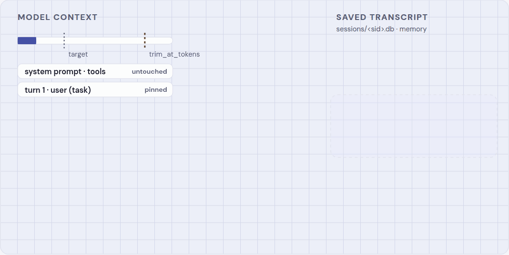
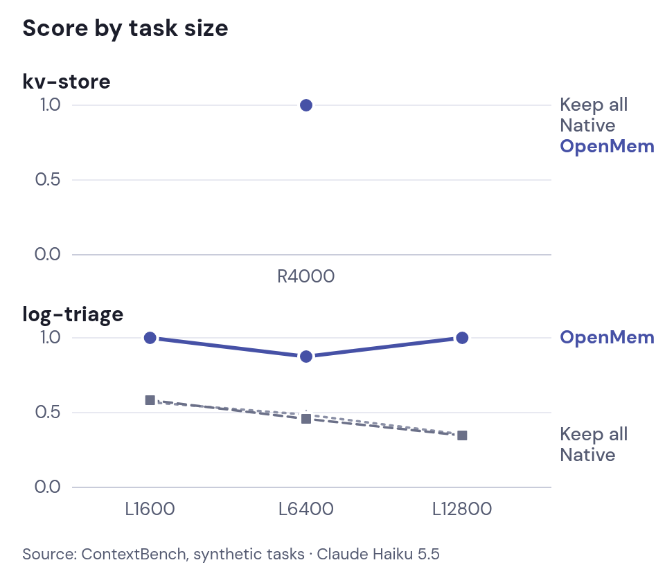

# Smarter Compact

**Context management (smart compaction)** keeps long coding-agent sessions under a token limit without an LLM summary. Every message goes into a local SQLite session store; older turns leave the context and the turn they precede carries a pointer to them. The agent searches the store with `smart_compact_search`, `smart_compact_sql`, and `smart_compact_get` when it needs a detail back. The cut stays put on later requests, so the prompt cache keeps hitting.

<p align="center">
<picture>
<source media="(prefers-color-scheme: dark)" srcset="docs/media/smart-compaction-dark.gif" />

</picture>
</p>

**Learn more:** [Smart compaction](https://bcmyguest.github.io/smarter-compact/context-management.html) (benchmarks and how it trims) · [Context proxy & port](https://bcmyguest.github.io/smarter-compact/context-proxy.html) · [Context store](https://bcmyguest.github.io/smarter-compact/context-store.html)

**Benchmarks:** In seed-matched [ContextBench](https://github.com/RulinShao/ContextBench) log tasks on Haiku 5.5, smart compaction scored **0.469** higher than keep-everything (95% bootstrap interval 0.339–0.578; eight pairs). All arms scored 1.0 on kv R4000. Costs fell at R4000, L6400, and L12800. [Full tables and charts](https://bcmyguest.github.io/smarter-compact/context-management.html#benchmarks) · [methods](https://bcmyguest.github.io/smarter-compact/context-research.html).

<p align="center">
<picture>
<source media="(prefers-color-scheme: dark)" srcset="docs/media/contextbench-quality-compact-dark.png" />

</picture>
</p>

The trimmer is the OpenMem context proxy and its OpenCode port, extracted into this repository. The stored text still uses the OpenMem wire format (`[openmem: …]`, `<openmem-recall>`). Memory recall on a trim is off unless you set `CONTEXT_COMPACTION_RECALL=1`.

You need Node 24 or newer (for `node:sqlite`) and, for agents that trim through the proxy, the LiteLLM dev build `v1.109.0-dev.1` on `PATH` as `litellm`. The plugin has no API key of its own. Your agent keeps its own login.

## Install

Use the **npm package** when it is published (`npm install -g smarter-compact`). Plugin marketplaces need the package directory on disk once; you do not need a git clone for that. A **git clone** is optional if you are developing the trimmer or prefer a fixed checkout path.

### Claude Code

```sh
npm install -g smarter-compact
ROOT="$(npm root -g)/smarter-compact"
claude plugin marketplace add "$ROOT"
claude plugin install smarter-compact@smarter-compact
smarter-compact enable claude
```

Start a new `claude` session after `enable`. The marketplace install registers the search tools and the compact command. `enable` points `ANTHROPIC_BASE_URL` at `http://127.0.0.1:4101`, starts the LiteLLM proxy in the background when needed, and stores a key in `~/.config/smarter-compact/proxy.env` (mode 600). Session hooks also ensure the proxy is up. A previous base URL is saved in `~/.config/smarter-compact/proxy-backup.json` and restored by `smarter-compact disable claude`. Logs: `~/.config/smarter-compact/proxy.log`. Set `SMARTER_COMPACT_AUTO_PROXY=0` to disable auto-start.

<details>
<summary>Optional: install from a git clone</summary>

```sh
git clone https://github.com/bcmyguest/smarter-compact.git
cd smarter-compact
claude plugin marketplace add "$PWD"
claude plugin install smarter-compact@smarter-compact
./plugin/scripts/smarter-compact enable claude
```

Leave the clone in place; Claude resolves the marketplace from that path.

</details>

### Codex

```sh
npm install -g smarter-compact
ROOT="$(npm root -g)/smarter-compact"
codex plugin marketplace add "$ROOT"
codex plugin add smarter-compact@smarter-compact
smarter-compact enable codex
```

`enable` sets `model_provider = "smarter-compact"` in `~/.codex/config.toml`. Codex keeps its ChatGPT login: the provider uses `requires_openai_auth` and LiteLLM's `/backend-api/codex` pass-through. Trust the hooks, quit Codex, and start it again.

<details>
<summary>Optional: install from a git clone</summary>

```sh
git clone https://github.com/bcmyguest/smarter-compact.git
cd smarter-compact
codex plugin marketplace add "$PWD"
codex plugin add smarter-compact@smarter-compact
./plugin/scripts/smarter-compact enable codex
```

</details>

### Copilot CLI

```sh
npm install -g smarter-compact
ROOT="$(npm root -g)/smarter-compact"
copilot plugin marketplace add "$ROOT"
copilot plugin install smarter-compact@smarter-compact
```

The plugin registers the search tools and the compact hook. Copilot's model URL is not rewritten. Trimming on Copilot requires the CLI to send model traffic through the proxy yourself.

<details>
<summary>Optional: install from a git clone</summary>

```sh
git clone https://github.com/bcmyguest/smarter-compact.git
cd smarter-compact
copilot plugin marketplace add "$PWD"
copilot plugin install smarter-compact@smarter-compact
```

</details>

### Pi

```sh
pi install git:github.com/bcmyguest/smarter-compact
```

`/smarter-compact status` and `/smarter-compact compact` call the same command as the other agents. Pi does not rewrite the outgoing model request, so a trim happens only when that request already goes through the proxy.

<details>
<summary>Optional: git clone (local extension path)</summary>

```sh
git clone https://github.com/bcmyguest/smarter-compact.git
# Point Pi at smarter-compact/plugin/pi/smarter-compact.js per Pi's local-extension docs.
```

</details>

### Cursor Agent

```sh
npm install -g smarter-compact
smarter-compact install cursor
```

This symlinks the bundled `plugin/` tree into `~/.cursor/plugins/local/smarter-compact` (use `smarter-compact install cursor --copy` if symlinks are blocked). Reload Cursor and enable the local plugin. Hooks record compact requests; MCP serves `smart_compact_*`. Cursor does not rewrite the model request from a hook.

<details>
<summary>Optional: install from a git clone</summary>

```sh
git clone https://github.com/bcmyguest/smarter-compact.git
cd smarter-compact
./plugin/scripts/smarter-compact install cursor
```

</details>

### OpenCode

```sh
npm install -g smarter-compact
opencode plugin smarter-compact        # project .opencode/opencode.json
opencode plugin -g smarter-compact   # global ~/.config/opencode/
```

**OpenCode 2** trims in the plugin (`context` hook). Add options on the plugin entry if you need them; see [docs/opencode.md](docs/opencode.md).

**OpenCode 1** has no context hook, so run `smarter-compact enable opencode` as well (the plugin starts the proxy when the agent is pointed at it). `enable opencode` refuses a proxy base URL when `opencode --version` reports major 2.

<details>
<summary>Optional: install from a git clone</summary>

```sh
git clone https://github.com/bcmyguest/smarter-compact.git
cd smarter-compact
opencode plugin "$PWD"               # or ./index.mjs if your OpenCode build accepts a file path
opencode plugin -g "$PWD"
smarter-compact enable opencode                   # OpenCode 1 only
```

</details>

## CLI

After `npm install -g smarter-compact`, the command on your PATH is **`smarter-compact`**. From a clone, use `./plugin/scripts/smarter-compact` (or `node plugin/scripts/smarter-compact.mjs`).

## Commands

| Command | Effect |
| --- | --- |
| `/smarter-compact:status` | Trims, estimated tokens saved, and fail-opens in the last day |
| `/smarter-compact:compact` | Trim on the next request. The hook writes `sessions/<id>.force` |
| `smarter-compact enable <claude\|codex\|opencode>` | Point that agent at the proxy |
| `smarter-compact disable <claude\|codex\|opencode>` | Remove that pointing and restore the backup |
| `smarter-compact proxy` | Run LiteLLM in the foreground (debugging; hooks normally start it detached) |
| `smarter-compact status` | Same numbers as the slash command |

A fail-open sends the request on untrimmed and records the error. The request is not blocked.

## Where state lives

`OPENMEM_STATE_DIR` defaults to `~/.local/share/smarter-compact` for smarter-compact and the plugin. The store is `$OPENMEM_STATE_DIR/context`. Schema and file layout: [docs/context-store.md](docs/context-store.md).

| Variable | Default | Effect |
| --- | --- | --- |
| `CONTEXT_PROXY_ENABLED` | `1` | `0` forwards every request unchanged |
| `CONTEXT_TRIM_AT_TOKENS` | unset: 95000 when the model id contains `haiku`, else 125000 | Estimated prompt size that triggers a trim (or `/smarter-compact:compact`). Set one integer (shell, `proxy.env`, or OpenCode `trimAtTokens`) to use that threshold for **every** model. |
| `CONTEXT_TRIM_TO_FRACTION` | `0.3` | In-turn tool steps kept while the request stays under this fraction of the threshold |
| `CONTEXT_COMPRESS_OVER_TOKENS` | `4000` | Tool results above this are stored in full and replaced by a short header |
| `CONTEXT_COMPACTION_RECALL` | `0` by default | `1` asks a memory bank named on the session registration |
| `CONTEXT_PROXY_PORT` | `4101` | LiteLLM listen port (env overrides `~/.config/smarter-compact/proxy.env`; `smarter-compact enable` writes the port in use) |

### Proxy port

Default is **4101**. To use another port:

```sh
export CONTEXT_PROXY_PORT=4200
smarter-compact enable claude    # agent URLs and proxy.env both use 4200
```

Or set it once in `~/.config/smarter-compact/proxy.env` (same file as the LiteLLM key), then run `smarter-compact enable` again so agent configs pick up the port. The hook and auto-started proxy also read trim settings from that file when they are not already in the environment:

```
CONTEXT_PROXY_PORT=4200
# CONTEXT_TRIM_AT_TOKENS=120000   # optional: one threshold for all models
```

OpenCode 2 plugin options: `"proxyPort": 4200` in the plugin entry (maps to `CONTEXT_PROXY_PORT` for in-process trim settings; proxy auto-start uses the same resolution).

## Tests

```
python3 -m unittest discover -s proxy/tests
node --test tests/plugin.test.mjs
```

The Python package is still `openmem_context`. `plugin/lib/context-trim.mjs` is the OpenCode port of that package; the two stay on the same store contract.

## License

Apache-2.0. The trimmer comes from [openmem](https://github.com/bcmyguest/openmem).
