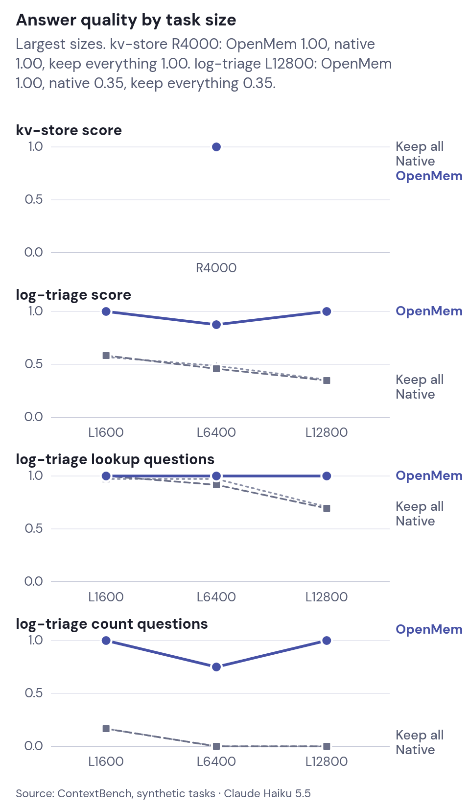
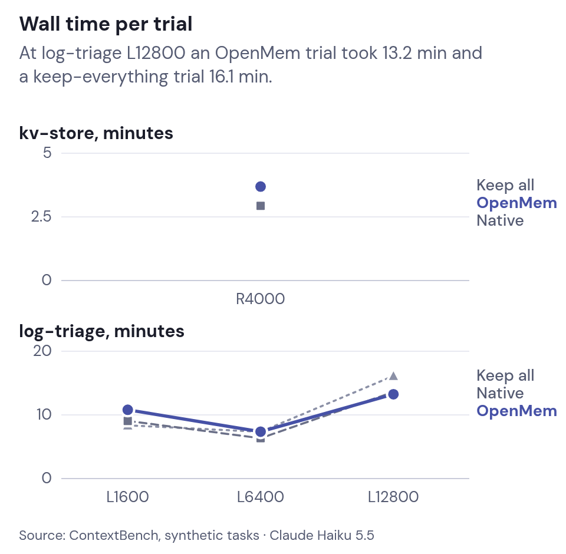
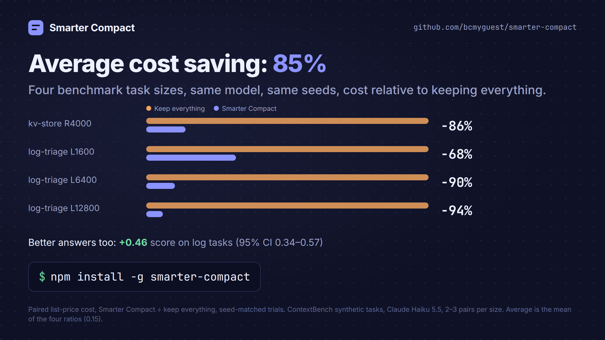
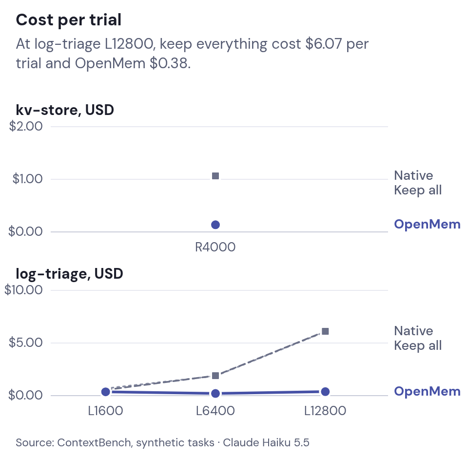
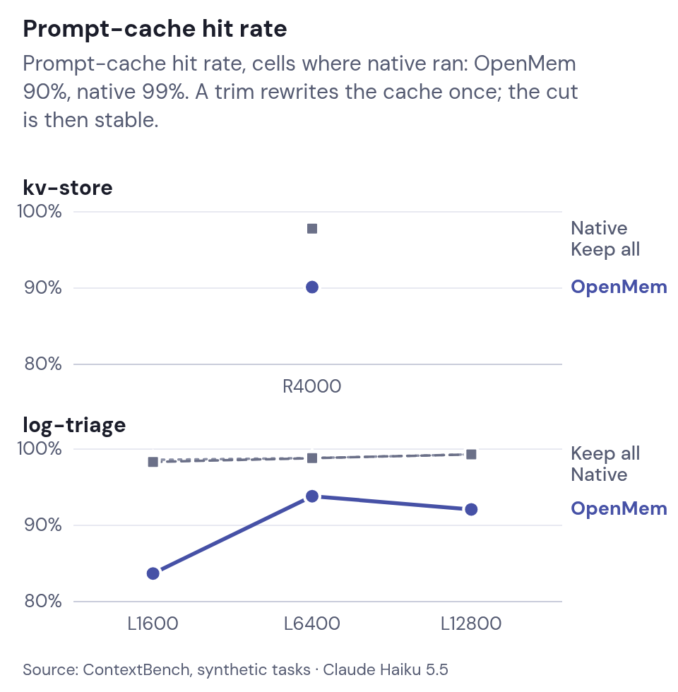

# Benchmarks

On ContextBench with Claude Haiku 5.5, smart compaction cost 85% less than keeping everything, averaged over four task sizes, and scored higher on every log-triage size. On kv-store every setting scored 1.00.

The benchmark is [ContextBench](https://github.com/RulinShao/ContextBench) (Context Language Models, [arXiv:2609.37725](https://arxiv.org/abs/2609.37725), [Hugging Face dataset](https://huggingface.co/datasets/context-language-model/ContextBench)). `kv-store` asks for earlier values; `log-triage` asks lookup and count questions. Three settings ran on the same held-out seeds through Claude Code in headless strict mode, which has no Bash or file tools:

- keep everything;
- Claude Code's default native compaction, which never compacted in these tasks;
- **Smarter Compact** smart compaction, the trimmer in this repo.

The cost saving and the score difference come from [run G](context-research.md#run-g-current-defaults-against-run-e-baselines-2026-11-09) (2026-11-09): the smart setting rerun at v0.9.0 on the same seeds, paired with run E's keep-everything trials, which have no proxy. The quality, time and cost charts and tables below are run E (2026-10-30), whose smart setting predates input clearing, the scratchpad and the other current defaults.

Each cell has two or three seeds. Method and limits: [Context research](context-research.md) and the [evidence plan](https://github.com/bcmyguest/openmem/blob/main/docs/evidence-plan.md#completed-seed-paired-comparisons), which covers the bootstrap intervals. The bench harness lives in OpenMem.

<picture>
<source media="(prefers-color-scheme: dark)" srcset="media/contextbench-quality-dark.png" />

</picture>

Source: [ContextBench](https://github.com/RulinShao/ContextBench) synthetic tasks, Claude Haiku 5.5. Score is reward_lenient (tag-insensitive), the mean over the completed seeds of each cell. † a seed dropped the `#tag` from its kv answers and scored 0 under the strict reward; the values were right. ‡ the harness step limit stopped the trial before any question, so the 0 is not a recall score.

| Task, size | Smarter Compact | Native compaction (default) | Keep everything |
| --- | --- | --- | --- |
| kv-store R4000 | 1.00 †, n = 3 | 1.00 †, n = 3 | 1.00, n = 3 |
| log-triage L1600 | 1.00 (lookup 1.00, count 1.00), n = 3 | 0.58 (lookup 1.00, count 0.17), n = 3 | 0.57 (lookup 0.97, count 0.17), n = 3 |
| log-triage L6400 | 0.88 (lookup 1.00, count 0.75), n = 3 | 0.46 (lookup 0.92, count 0.00), n = 3 | 0.49 (lookup 0.97, count 0.00), n = 3 |
| log-triage L12800 | 1.00 (lookup 1.00, count 1.00), n = 3 | 0.35 (lookup 0.69, count 0.00), n = 3 | 0.35 (lookup 0.71, count 0.00), n = 2 |

# Time

Native compaction never fired. The largest prompt reached 764,310 tokens, below Claude Code's default auto-compact point of about 967K for Haiku 5.5, so the default native setting acts as a second keep-everything setting. Forced to compact near 120K, native compaction scored 0.028–0.333 on the log tasks ([results](context-research.md#sensitivity-arm-native-compaction-at-a-153k-window-e-native-153k)). The usage log does not show which request paid for a new trim, so these runs give no trim-latency estimate.

<picture>
<source media="(prefers-color-scheme: dark)" srcset="media/contextbench-time-dark.png" />

</picture>

| Setting | Trials | Agent wall time per trial, mean | Requests | Request latency, mean | Prompt-cache hit rate |
| --- | --- | --- | --- | --- | --- |
| Smarter Compact | 12 | 8.8 min | 2103 | 1.83 s | 90% |
| Native compaction (default) | 12 | 8.0 min | 1831 | 2.12 s | 99% |
| Keep everything | 11 | 8.2 min | 1567 | 2.47 s | 99% |

Smart compaction takes longer per trial than native compaction (527 s vs 479 s) and makes more requests per trial (175 vs 153), store searches included.

# Cost and prompt cache

Smart compaction saved **85% on average** across the four sizes (run G). Per size it cost 0.140 times as much as keeping everything at kv R4000, 0.318 at L1600, 0.102 at L6400 and 0.059 at L12800; the mean of these four ratios is 0.155. Each ratio compares runs on the same seed, and every interval lies below 1. Run E's smart setting saved 72% (mean ratio 0.278); its L1600 interval crossed 1. The [research page](context-research.md#run-g-current-defaults-against-run-e-baselines-2026-11-09) gives each interval.

<picture>
<source media="(prefers-color-scheme: dark)" srcset="media/contextbench-cost-dark.png" />

</picture>

<picture>
<source media="(prefers-color-scheme: dark)" srcset="media/contextbench-cache-dark.png" />

</picture>

Source: [ContextBench](https://github.com/RulinShao/ContextBench) synthetic tasks. Cost applies Claude Haiku 5.5 list prices to each request's token counts. Cache hit rate is cache reads over all prompt tokens (input, cache reads and cache writes) of a cell's requests. Peak prompt is the largest single request.

| Task, size | List-price cost per trial (smart / native / keep) | Prompt-cache hit rate (smart / native / keep) | Tokens per trial, cache reads in parentheses (smart / native / keep) | Peak prompt (smart / native / keep) |
| --- | --- | --- | --- | --- |
| kv-store R4000 | $0.14 / $1.07 / $1.05 | 90% / 98% / 98% | 4.6M (4.1M) / 16.1M (15.7M) / 15.7M (15.4M) | 93k / 359k / 359k |
| log-triage L1600 | $0.36 / $0.54 / $0.68 | 84% / 98% / 99% | 7.9M (6.5M) / 10.2M (10.0M) / 12.5M (12.3M) | 94k / 218k / 268k |
| log-triage L6400 | $0.20 / $1.90 / $1.87 | 94% / 99% / 99% | 8.9M (8.3M) / 32.6M (32.2M) / 32.3M (31.9M) | 96k / 397k / 388k |
| log-triage L12800 | $0.38 / $6.11 / $6.07 | 92% / 99% / 99% | 14.4M (13.2M) / 109.3M (108.6M) / 108.8M (108.0M) | 95k / 764k / 762k |

# What this shows

On the log tasks smart compaction scored **0.464** higher than keep everything (95% interval 0.339–0.573, eight paired trials; run G). It scored **0.491** higher than default native, which never compacted here (0.361–0.597, nine pairs). Run E gave 0.469 and 0.495. All three settings scored 1.0 on kv R4000. Smart compaction cost less on every paired trial at every size. At L1600 the wall-time interval includes a slowdown over 20% (ratio 1.290, 0.501–2.210). The samples are small and synthetic, so they do not show the effect carries over to coding sessions.

Each pair runs both settings on the same seed. The intervals above bootstrap over pairs. A bootstrap that resamples the three task sizes gives 0.324–0.639 against keep everything and 0.329–0.648 against default native (run E: 0.329–0.639 and 0.352–0.648) ([deviations from the pre-registration](context-research.md#deviations-from-the-pre-registration)).

On Sonnet 5 at log L6400 (two paired seeds), smart compaction scored 0.0625 higher (0.0417–0.0833) and cost 0.401 times as much as keep everything (0.361–0.441). [Exclusions, price basis, and pending work](https://github.com/bcmyguest/openmem/blob/main/docs/evidence-plan.md#completed-seed-paired-comparisons).

# Compact-Bench (real coding sessions)

[Compact-Bench](https://github.com/cai-jianfeng/compact-bench) Task Preservation track resumes real SWE-bench repair sessions after compaction. Results for Smarter Compact vs full history and native summaries are **pending** (harness adapter lives in the OpenMem repo).

How trimming works: [How it works](context-management.md).
