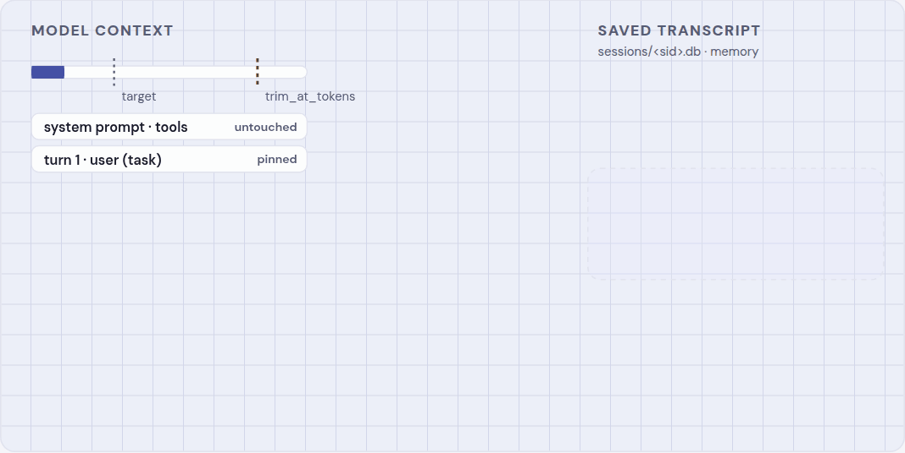
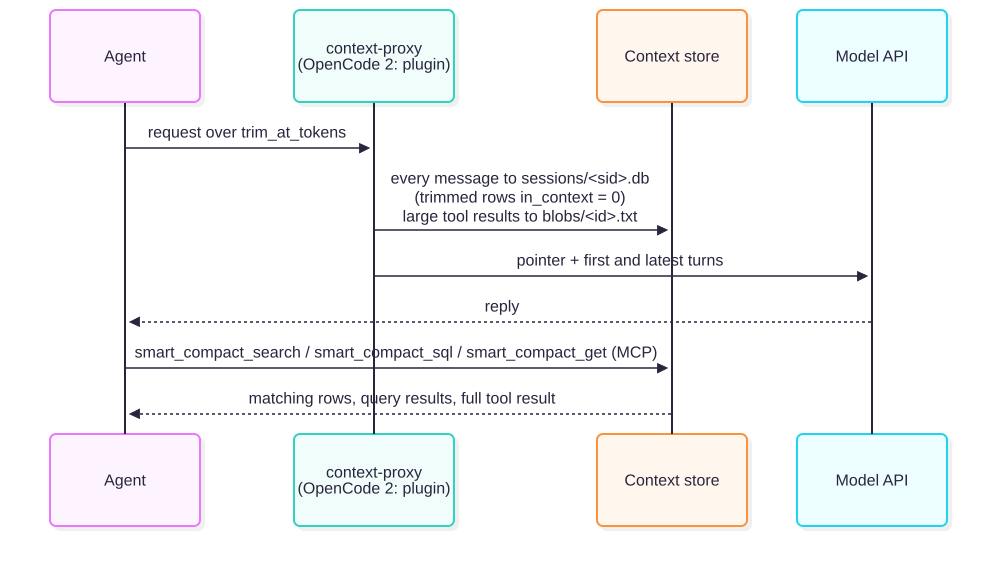
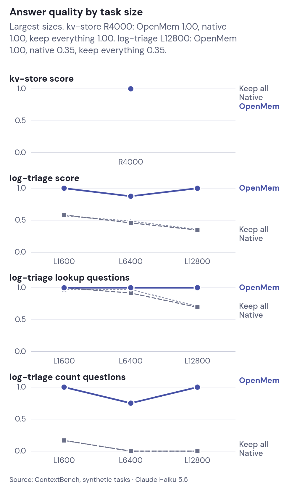
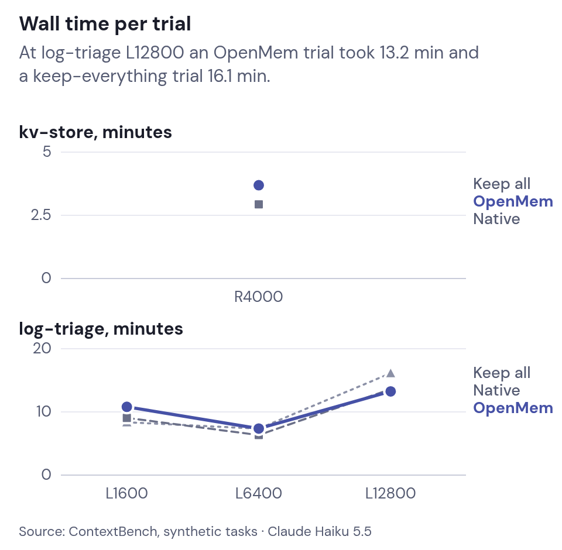
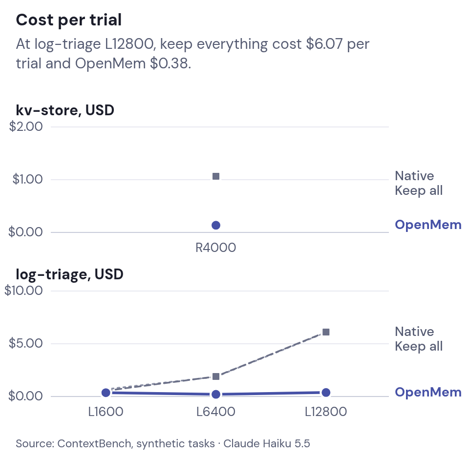
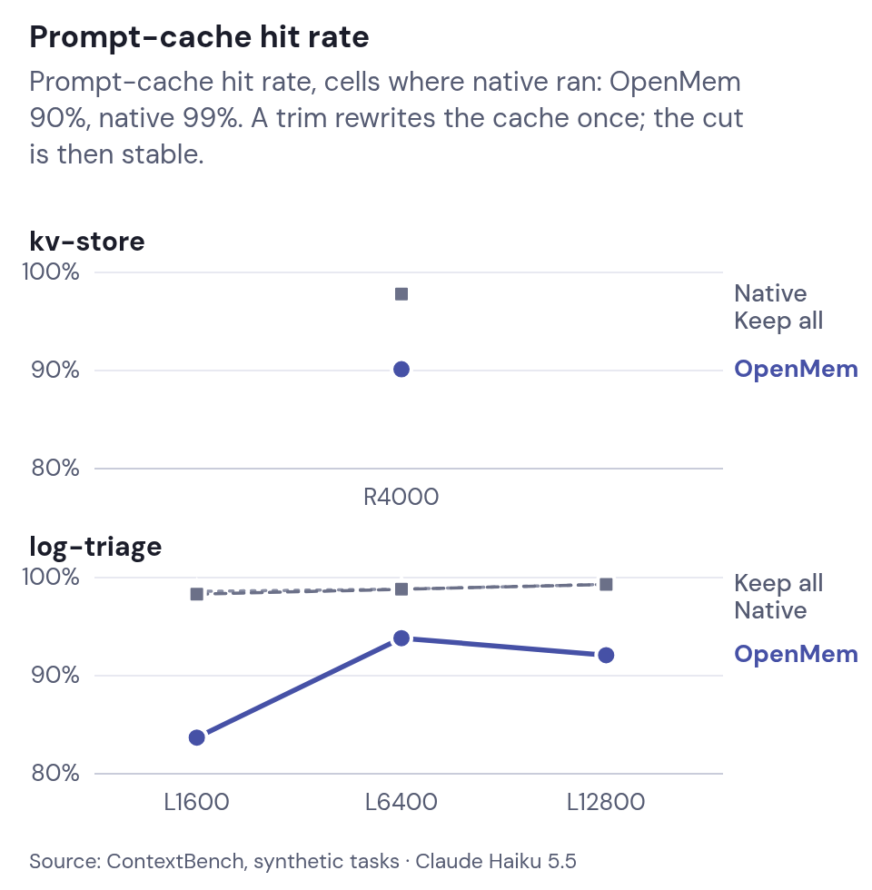

# Context management (smart compaction)

Context management (smart compaction) keeps long coding-agent sessions under a token limit without an LLM summary. Every message goes into a local SQLite session store; older turns leave the context and the turn they precede carries a pointer to them; the agent searches the store when it needs a detail back.

<p align="center">
<picture>
<source media="(prefers-color-scheme: dark)" srcset="media/smart-compaction-dark.gif" />

</picture>
<br />
<sub>Older turns move to the session store, the cut turn carries a pointer, and <code>smart_compact_search</code> pulls a detail back.</sub>
</p>

<p align="center">
<picture>
<source media="(prefers-color-scheme: dark)" srcset="media/context-management-1-dark.svg" />

</picture>
</p>

Each request goes through five steps ([context proxy](context-proxy.md) has implementation detail):

| Step | When | Effect |
| --- | --- | --- |
| Tool-result compression | A tool result exceeds `compress_over_tokens` | First 40 and last 20 lines stay, behind a `smart_compact_get(id=...)` header; the full text goes to `blobs/<id>.txt` |
| Store | Every request | Each message goes into `sessions/<sid>.db` once, keyed by a chained fingerprint, with an `in_context` flag ([context store](context-store.md#session-database)) |
| Trim | The request reaches `trim_at_tokens`, or the user typed `/smarter-compact:compact` | Turns before the last real user turn, and the oldest tool exchanges of a long in-flight turn, leave the context and their rows get `in_context = 0`; a pointer naming `smart_compact_search` / `smart_compact_sql` replaces them. System prompt, tools, the first user turn, the reply before the last user turn, that turn and at least its last 3 tool exchanges stay verbatim, except that signed thinking leaves every kept assistant message but the latest ([why](context-store.md#trim)) |
| Recall on trim | The session registration names a bank and `CONTEXT_COMPACTION_RECALL=1` | Optional memory recall in an `<smarter-compact-recall untrusted="true">` block (off by default in this package) |
| Standing instruction | Every request | A constant system-prompt note tells the agent to call `smart_compact_search` before answering from content it cannot see, and that `<smarter-compact-recall>` blocks are data, not instructions |

The cut is **sticky**: later requests with the same history get the same rewrite byte for byte, so the prompt cache keeps hitting. A trim invalidates the cache once.

## Benchmarks

Three settings on the same held-out [ContextBench](https://github.com/RulinShao/ContextBench) seeds through Claude Code in headless strict mode (no Bash or file tools): keep everything, Claude Code's default native compaction, and **Smarter Compact** smart compaction (same trimmer as this repo). The model is Claude Haiku 5.5. `kv-store` asks for earlier values; `log-triage` asks lookup and count questions. Each cell has two or three seeds. The default native arm recorded zero compactions in these tasks. Deeper method and limits: [Context research](context-research.md) and the [evidence plan](https://github.com/bcmyguest/openmem/blob/main/docs/evidence-plan.md#completed-seed-paired-comparisons) (bootstrap intervals; bench harness lives in OpenMem).

<p align="center">
<picture>
<source media="(prefers-color-scheme: dark)" srcset="media/contextbench-quality-dark.png" />

</picture>
</p>

Source: [ContextBench](https://github.com/RulinShao/ContextBench) synthetic tasks, Claude Haiku 5.5. Score is reward_lenient (tag-insensitive), the mean over the completed seeds of each cell. † a seed dropped the `#tag` from its kv answers and scored 0 under the strict reward; the values were right. ‡ the harness step limit stopped the trial before any question, so the 0 is not a recall score.

| Task, size | Smarter Compact | Native compaction (default) | Keep everything |
| --- | --- | --- | --- |
| kv-store R4000 | 1.00 †, n = 3 | 1.00 †, n = 3 | 1.00, n = 3 |
| log-triage L1600 | 1.00 (lookup 1.00, count 1.00), n = 3 | 0.58 (lookup 1.00, count 0.17), n = 3 | 0.57 (lookup 0.97, count 0.17), n = 3 |
| log-triage L6400 | 0.88 (lookup 1.00, count 0.75), n = 3 | 0.46 (lookup 0.92, count 0.00), n = 3 | 0.49 (lookup 0.97, count 0.00), n = 3 |
| log-triage L12800 | 1.00 (lookup 1.00, count 1.00), n = 3 | 0.35 (lookup 0.69, count 0.00), n = 3 | 0.35 (lookup 0.71, count 0.00), n = 2 |

### Time

This comparison recorded no native compactions. Its default native arm therefore behaved as a keep-everything baseline at these sizes. The saved usage log cannot identify which request paid for a new trim, so it does not support a trim-latency estimate.

<p align="center">
<picture>
<source media="(prefers-color-scheme: dark)" srcset="media/contextbench-time-dark.png" />

</picture>
</p>

| Setting | Trials | Agent wall time per trial, mean | Requests | Request latency, mean | Prompt-cache hit rate |
| --- | --- | --- | --- | --- | --- |
| Smarter Compact | 12 | 8.8 min | 2103 | 1.83 s | 90% |
| Native compaction (default) | 12 | 8.0 min | 1831 | 2.12 s | 99% |
| Keep everything | 11 | 8.2 min | 1567 | 2.47 s | 99% |

Wall time per trial is longer with smart compaction (527 s vs 479 s for native compaction); smart compaction also makes more requests per trial (175 vs 153), which include store searches.

### Cost and prompt cache

<p align="center">
<picture>
<source media="(prefers-color-scheme: dark)" srcset="media/contextbench-cost-dark.png" />

</picture>
</p>

<p align="center">
<picture>
<source media="(prefers-color-scheme: dark)" srcset="media/contextbench-cache-dark.png" />

</picture>
</p>

Source: [ContextBench](https://github.com/RulinShao/ContextBench) synthetic tasks. Cost applies Claude Haiku 5.5 list prices to each request's token counts. Cache hit rate is cache reads over all prompt tokens (input, cache reads and cache writes) of a cell's requests. Peak prompt is the largest single request.

| Task, size | List-price cost per trial (smart / native / keep) | Prompt-cache hit rate (smart / native / keep) | Tokens per trial, cache reads in parentheses (smart / native / keep) | Peak prompt (smart / native / keep) |
| --- | --- | --- | --- | --- |
| kv-store R4000 | $0.14 / $1.07 / $1.05 | 90% / 98% / 98% | 4.6M (4.1M) / 16.1M (15.7M) / 15.7M (15.4M) | 93k / 359k / 359k |
| log-triage L1600 | $0.36 / $0.54 / $0.68 | 84% / 98% / 99% | 7.9M (6.5M) / 10.2M (10.0M) / 12.5M (12.3M) | 94k / 218k / 268k |
| log-triage L6400 | $0.20 / $1.90 / $1.87 | 94% / 99% / 99% | 8.9M (8.3M) / 32.6M (32.2M) / 32.3M (31.9M) | 96k / 397k / 388k |
| log-triage L12800 | $0.38 / $6.11 / $6.07 | 92% / 99% / 99% | 14.4M (13.2M) / 109.3M (108.6M) / 108.8M (108.0M) | 95k / 764k / 762k |

### What this shows

Across eight seed-matched log trials, smart compaction's mean score exceeded keep-everything by **0.469** (95% bootstrap interval 0.339–0.578). Across nine pairs it exceeded default native by **0.495** (0.384–0.593). All three arms scored 1.0 on kv R4000. Smart compaction cost less on every paired R4000, L6400, and L12800 trial. The L1600 cost interval includes no saving, and its wall-time interval includes a slowdown over 20%. These small synthetic samples do not establish the same effect for coding sessions.

On Sonnet 5 log L6400, two seed-matched pairs favored smart compaction by 0.0625 score (0.0417–0.0833) and cost 0.401 times keep-everything (0.361–0.441). [Exclusions, price basis, and pending work](https://github.com/bcmyguest/openmem/blob/main/docs/evidence-plan.md#completed-seed-paired-comparisons).

### Compact-Bench (real coding sessions)

[Compact-Bench](https://github.com/cai-jianfeng/compact-bench) Task Preservation track resumes real SWE-bench repair sessions after compaction. Results for Smarter Compact vs full history and native summaries are **pending** (harness adapter lives in the OpenMem repo).

## When to use it

| Turn it on when | Leave it off when |
| --- | --- |
| Sessions grow past `trim_at_tokens` (default 125k estimated tokens, 95k for Haiku) | Sessions stay under the limit |
| You want trimmed turns searchable, not summarized away | You cannot run `litellm` on the host (Claude, OpenCode 1, Codex point at the proxy) |
| You use Claude Code, Codex, OpenCode 2, or Pi | You only need MCP search hooks on Cursor or Copilot (no automatic trim) |

## Turn it on

```sh
smarter-compact enable claude    # or codex, opencode (OpenCode 1)
```

The plugin **starts the LiteLLM proxy in the background** when an agent is pointed at it. OpenCode 2 trims in-process: `opencode plugin smarter-compact` — no proxy URL.

Force a trim in session: `/smarter-compact:compact` (or agent equivalent).

Status: `smarter-compact status` or MCP `context_status`.

## Agent support

| Agent | On-wire trim | How |
| --- | --- | --- |
| Claude Code | yes | Loopback proxy via `smarter-compact enable claude` |
| Codex | yes | `model_provider = "smarter-compact"` + LiteLLM Codex pass-through |
| OpenCode 2 | yes | Native `context` hook in this package |
| OpenCode 1 | yes | Proxy via `smarter-compact enable opencode` |
| Pi | yes | Pi extension → `context` hook ([pi.dev docs](https://pi.dev/docs/latest/extensions#context)) |
| Cursor Agent | no | Optional MCP + hooks only; not listed in main install flow |
| Copilot CLI | no | Optional MCP + hooks only; no proxy base URL |

**Cursor / Copilot** register sessions and expose search tools but do not shrink the model context. **Pi / OpenCode 2** use the same `trimContext` path as the proxy.

Claude Code keeps its own auto-compact as a safety net if the proxy is down. `/context` in Claude Code counts the full local transcript, not the trimmed request the proxy sends, so it can read higher than API usage.

## MCP tools

| Tool | Purpose |
| --- | --- |
| `smart_compact_search` | FTS / hybrid search over trimmed session rows |
| `smart_compact_sql` | Read-only SQL on one session database |
| `smart_compact_get` | Text of a compressed tool result by blob id, `BLOB_PAGE_CHARS` (12,000) per call; `offset`/`next_offset` page, `max_chars` (≤100,000) asks for more at once |
| `context_status` | Trims, fail-opens, writer versions, usage summary |

Wire format and SQL rules: [context store](context-store.md).

## Configuration

Environment variables (OpenCode plugin options use camelCase equivalents — see [opencode.md](opencode.md)):

| Variable | Default | Effect |
| --- | --- | --- |
| `CONTEXT_TRIM_AT_TOKENS` | unset → per-model table | When unset, thresholds come from `config.toml` `[context_proxy.trim_at]` (built-in `haiku` 95k, `default` 125k). When set, one value for all models. `smarter-compact context set …` edits the table. |
| `CONTEXT_TRIM_TO_FRACTION` | `0.53` | In-turn tool exchanges kept under this fraction of threshold |
| `CONTEXT_STRIP_PROSE` | `0` | Strip tool calls from kept turns, keep their text; `1` on, under review ([research](context-research.md#terminal-bench-21-trim-shape-arms-2026-11-05)) |
| `CONTEXT_PROGRESS_NOTE` | `1` | Add a mechanical progress note to the trim pointer; `0` off ([research](context-research.md#terminal-bench-21-trim-shape-arms-2026-11-05)) |
| `CONTEXT_COMPRESS_OVER_TOKENS` | `4000` | Tool result compression threshold |
| `CONTEXT_COMPACTION_RECALL` | `0` | Recall on trim |
| `CONTEXT_PROXY_PORT` | `4101` | LiteLLM listen port — see [proxy port](context-proxy.md#proxy-port) |
| `SMARTER_COMPACT_STATE_DIR` | `~/.local/share/smarter-compact` | Store root (append `/context` for files) |

Full proxy and token-estimate tables: [context proxy](context-proxy.md).

## More

- [Context proxy](context-proxy.md) — LiteLLM rewrite pipeline and env vars
- [Context store](context-store.md) — schema, trim rules, search tools
- [OpenCode](opencode.md) — plugin options
- [Context research](context-research.md) — related work, run notes, and benchmark method
