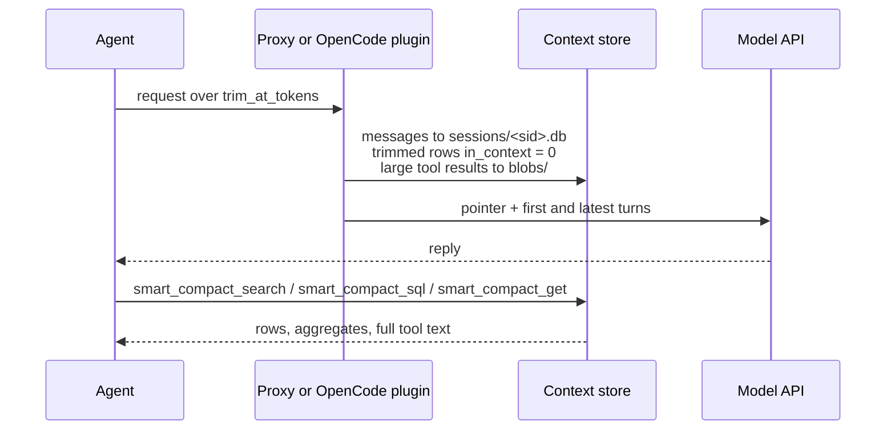

# Smart compaction

Smart compaction keeps long coding-agent sessions under a token limit without an LLM summary. Every message goes into a local SQLite session store; older turns leave the context and the turn they precede carries a pointer to them; the agent searches the store when it needs a detail back.

<p align="center">
<picture>
<source media="(prefers-color-scheme: dark)" srcset="https://bcmyguest.github.io/smarter-compact/media/smart-compaction-dark.gif" />

</picture>
<br />
<sub>Older turns move to the session store, the cut turn carries a pointer, and <code>smart_compact_search</code> pulls a detail back.</sub>
</p>



Each request goes through five steps ([context proxy](context-proxy.md) has implementation detail):

| Step | When | Effect |
| --- | --- | --- |
| Tool-result compression | A tool result exceeds `compress_over_tokens` | First 40 and last 20 lines stay behind a `smart_compact_get(id=...)` header; full text in `blobs/<id>.txt` |
| Store | Every request | Each message in `sessions/<sid>.db` once, with `in_context` ([context store](context-store.md#session-database)) |
| Trim | Request reaches `trim_at_tokens`, or `/smarter-compact:compact` | Older turns and oldest in-flight tool exchanges leave context; pointer names `smart_compact_search` / `smart_compact_sql` |
| Recall on trim | Session names a bank and `CONTEXT_COMPACTION_RECALL=1` | Optional memory recall in `<openmem-recall untrusted="true">` (off by default in this package) |
| Standing instruction | Every request | System note: call `smart_compact_search` before answering from content you cannot see |

The cut is **sticky**: later requests with the same history get the same rewrite byte for byte, so the prompt cache keeps hitting. A trim invalidates the cache once.

## When to use it

| Turn it on when | Leave it off when |
| --- | --- |
| Sessions grow past `trim_at_tokens` (default 125k estimated tokens, 95k for Haiku) | Sessions stay under the limit |
| You want trimmed turns searchable, not summarized away | You cannot run `litellm` on the host (Claude, OpenCode 1, Codex point at the proxy) |
| You use Claude Code, Codex, or OpenCode | You need only Cursor hooks without routing model traffic |

## Turn it on

```sh
sc enable claude    # or codex, opencode (OpenCode 1)
```

The plugin **starts the LiteLLM proxy in the background** when an agent is pointed at it. OpenCode 2 trims in-process: `opencode plugin smarter-compact` — no proxy URL.

Force a trim in session: `/smarter-compact:compact` (or agent equivalent).

Status: `sc status` or MCP `context_status`.

## Agent support

| Agent | Trim | How |
| --- | --- | --- |
| Claude Code | yes | Loopback proxy via `sc enable claude` |
| Codex | yes | `model_provider = "smarter-compact"` + LiteLLM Codex pass-through |
| OpenCode 2 | yes | Native `context` hook in this package |
| OpenCode 1 | yes | Proxy via `sc enable opencode` |
| Cursor / Copilot | partial | MCP search + compact hook; model URL not rewritten by default |

## MCP tools

| Tool | Purpose |
| --- | --- |
| `smart_compact_search` | FTS / hybrid search over trimmed session rows |
| `smart_compact_sql` | Read-only SQL on one session database |
| `smart_compact_get` | Full text of a compressed tool result by blob id |
| `context_status` | Trims, fail-opens, writer versions, usage summary |

Wire format and SQL rules: [context store](context-store.md).

## Configuration

Environment variables (OpenCode plugin options use camelCase equivalents — see [opencode.md](opencode.md)):

| Variable | Default | Effect |
| --- | --- | --- |
| `CONTEXT_TRIM_AT_TOKENS` | 95k Haiku / 125k else | Trim threshold |
| `CONTEXT_TRIM_TO_FRACTION` | `0.3` | In-turn tool exchanges kept under this fraction of threshold |
| `CONTEXT_COMPRESS_OVER_TOKENS` | `4000` | Tool result compression threshold |
| `CONTEXT_COMPACTION_RECALL` | `0` | Recall on trim |
| `CONTEXT_PROXY_PORT` | `4101` | LiteLLM listen port — see [proxy port](context-proxy.md#proxy-port) |
| `OPENMEM_STATE_DIR` | `~/.local/share/smarter-compact` | Store root (append `/context` for files) |

Full proxy and token-estimate tables: [context proxy](context-proxy.md).

## Benchmarks

ContextBench and Compact-Bench results for this design are published on the [OpenMem site](https://bcmyguest.github.io/openmem/docs/context-management.html) (memory stack repo). Methodology: [context research](https://github.com/bcmyguest/openmem/blob/main/docs/context-research.md) in openmem.
